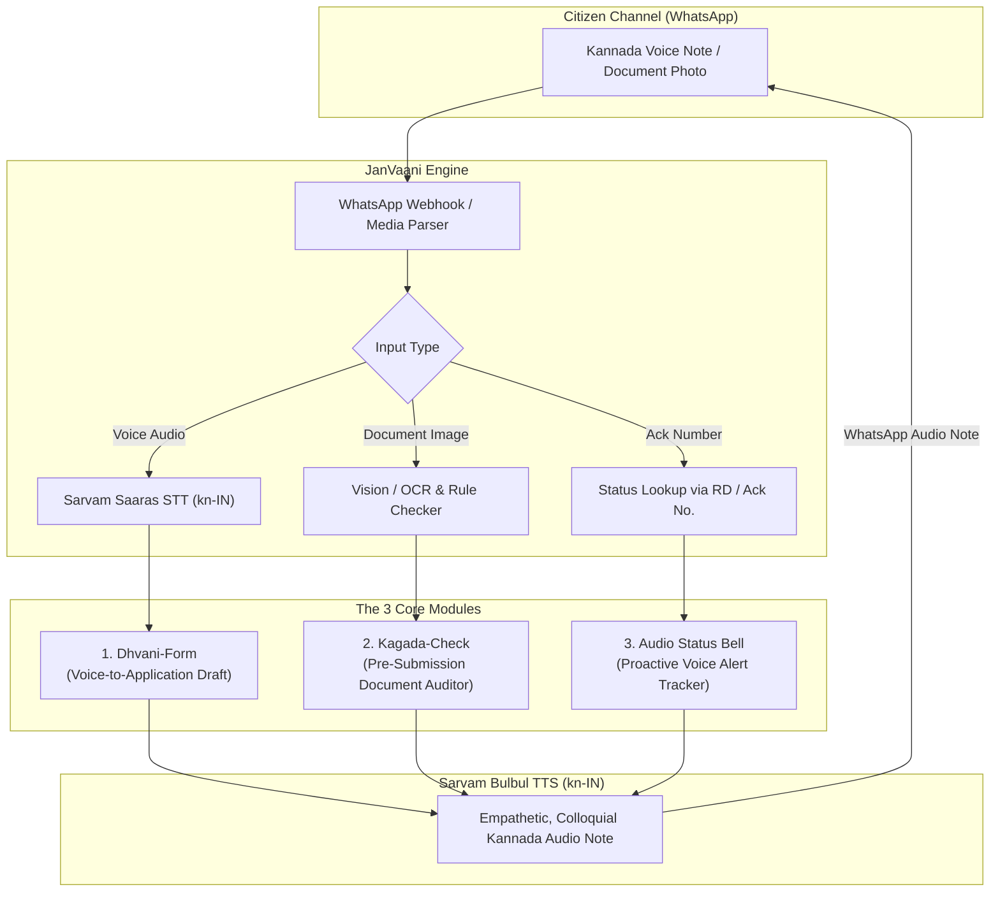
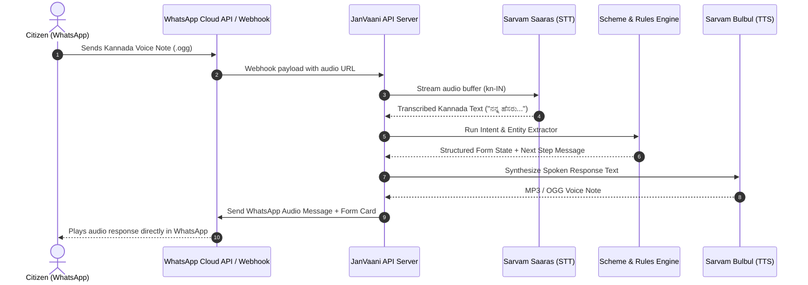

# JanVaani (ಜನವಾಣಿ): Comprehensive Project Dossier & Hackathon Defense Guide

> **Voice-First Civic Copilot for Karnataka Public Services powered by Sarvam AI & WhatsApp**

---

## 1. Problem Statement in Detail

### 1.1 The Ground Reality of Karnataka Citizens
Karnataka is home to over 68 million citizens. While Bengaluru is celebrated as the Silicon Valley of India, more than 60% of the state's population resides in rural and semi-urban taluks (across Hyderabad-Karnataka, Mumbai-Karnataka, Coastal, and Old Mysuru regions). 

For these citizens, accessing welfare schemes and statutory certificates—such as the **Gruha Lakshmi Scheme**, **Caste & Income Certificates**, **RTC/Pahani land records**, **Sandhya Suraksha pensions**, and **Ration Card corrections**—is a lifeline. Yet, exercising these rights is an uphill battle.

```
┌────────────────────────────────────────────────────────────────────────┐
│                   THE THREE BARRIERS CITIZENS FACE                     │
├───────────────────┬──────────────────────────┬─────────────────────────┤
│  Linguistic &      │  Digital & Interface     │  Administrative         │
│  Dialect Gap      │  Complexity              │  Opaqueness             │
├───────────────────┼──────────────────────────┼─────────────────────────┤
│ Portals use high- │ Multi-page forms,        │ Rejections occur        │
│ register legal    │ strict file upload rules │ silently with zero      │
│ Kannada or        │ (size/format), complex   │ actionable feedback;    │
│ administrative    │ drop-downs, and session  │ status checks require   │
│ English.          │ timeouts.                │ repeated travel.        │
└───────────────────┴──────────────────────────┴─────────────────────────┘
```

### 1.2 The Failure Modes of Current Systems
1. **The "Cyber-Café / Dalal (Middleman) Tax":**
   Because digital portals (*Seva Sindhu*, *Nadakacheri*, *Bhoomi*) are intimidating and cumbersome, citizens are forced to rely on local cyber-café operators or informal agents (*dalals*). These intermediaries charge **₹200 to ₹1,000 per application** for services that the government provides free or for nominal government fees (₹15–₹40).
2. **The "Silent Rejection" Disaster:**
   Government back-offices reject nearly **25%–35% of initial citizen applications** due to minor clerical mismatches:
   - Name spelling variations between Aadhaar and Ration Card (e.g., initial expanded vs. abbreviated).
   - Incomplete family tree (*Vamsha Vruksha*) affidavits.
   - Income ceiling crossed by a few rupees or outdated income slips.
   When an application is rejected, the portal generates a cryptic administrative code or generic rejection reason that the citizen cannot interpret.
3. **The Loss of Daily Wages:**
   When an application stalls, citizens take leave from agricultural labor or daily-wage work, spend money on bus fares, and stand in queues at Taluk or Nada Kacheri offices just to ask: *"Did my certificate come through?"*

### 1.3 Why a Traditional "Chatbot" is a Terrible Idea
Judges and civic tech evaluators rightly criticize typical hackathon chatbots for three reasons:
- **Literacy Bias:** Chatbots expect users to read paragraphs of text and type queries on an on-screen keyboard. Rural citizens are often semi-literate or uncomfortable typing in Kannada script.
- **Passivity & "Zero Execution":** A chatbot acts like a search engine—it reads out policy circulars or pastes portal links. Citizens don't need a summary of the law; they need someone to *fill the form and verify their papers*.
- **High Hallucination Risk:** Standard LLMs hallucinate eligibility criteria, deadlines, or required documents, giving citizens false legal hope or misleading guidance.

---

## 2. The Solution: Voice-First WhatsApp Civic Copilot

JanVaani flips the paradigm from a **passive text chatbot** to an **active, voice-first execution copilot**.



### 2.1 Why WhatsApp?
- **Zero App Friction:** Over 500 million Indians actively use WhatsApp. Rural families already know how to hold the microphone button to send a voice note and take a photo of a document.
- **No Installation Barrier:** Asking a farmer to download an Android APK from the Play Store or navigate a mobile web browser creates immediate drop-off.
- **Natural Media Support:** WhatsApp natively supports voice notes (`.ogg` Opus), high-resolution camera uploads, and location pins.

### 2.2 The Three Flagship Features
1. **Dhvani-Form (ಧ್ವನಿ ಅರ್ಜಿ - Voice-to-Application Engine):**
   - The citizen speaks naturally: *"ನನ್ನ ಹೆಸರು ಸವಿತಾ, ಗೃಹಲಕ್ಷ್ಮಿ ಯೋಜನೆಗೆ ಅರ್ಜಿ ಹಾಕಬೇಕು, ರೇಷನ್ ಕಾರ್ಡ್ ನಂಬರ್ RC9876543210"*
   - Sarvam STT transcribes the speech. JanVaani extracts the entities and maps them directly into Karnataka's official *Seva Sindhu* form schema.
   - If a required field is missing, JanVaani sends a brief spoken voice prompt asking specifically for that item.
   - Produces a finalized, structured application draft ready for digital submission or Grama One printing.
2. **Kagada-Check (ಕಾಗದ ಪರಿಶೀಲನೆ - Spoken Document & Eligibility Auditor):**
   - The citizen snaps a photo of their Aadhaar or Ration Card.
   - The engine performs OCR and cross-references the details against official scheme eligibility rules.
   - Instead of showing a technical error log, Sarvam TTS generates a clear, spoken Kannada diagnosis:
     > *"ನಿಮ್ಮ ಆದಾಯ ಮಿತಿ ₹1,50,000 ಅರ್ಹವಾಗಿದೆ. ಆದರೆ ನಿಮ್ಮ ಆಧಾರ್ ಕಾರ್ಡ್‌ನಲ್ಲಿರುವ ಹೆಸರು ಮತ್ತು ರೇಷನ್ ಕಾರ್ಡ್‌ನಲ್ಲಿರುವ ಹೆಸರು ಹೊಂದಿಕೆಯಾಗುತ್ತಿಲ್ಲ. ಅದನ್ನು ಸರಿಪಡಿಸಿ ಅರ್ಜಿ ಸಲ್ಲಿಸಿ."*
3. **Audio Status Bell (ಧ್ವನಿ ಸ್ಥಿತಿ ಗಂಟೆ - Proactive Voice Status Tracker):**
   - Citizen speaks or photographs their acknowledgment slip (e.g., `RD0038918291`).
   - JanVaani tracks the application progress across administrative stages (*Application Submitted ➔ Village Accountant / RI Verified ➔ Tahsildar Approved ➔ Certificate Dispatched*).
   - Whenever the stage changes, JanVaani delivers a proactive 15-second WhatsApp audio message in Kannada, completely eliminating unnecessary trips to taluk offices.

---

## 3. How Sarvam AI Powers JanVaani

JanVaani uses the **Sarvam AI Indic Suite** as its core intelligence layer:

```
┌────────────────────────────────────────────────────────────────────────┐
│                        SARVAM AI STACK IN JANVAANI                     │
├─────────────────────┬──────────────────────────────────────────────────┤
│ Module              │ Role in JanVaani                                 │
├─────────────────────┼──────────────────────────────────────────────────┤
│ Sarvam Saaras       │ Speech-to-Text for 8kHz/16kHz WhatsApp audio;     │
│ (STT - kn-IN)       │ handles colloquial Kannada & "Kanglish" terms.   │
├─────────────────────┼──────────────────────────────────────────────────┤
│ Sarvam Bulbul       │ Natural, warm text-to-speech rendering audio     │
│ (TTS - kn-IN)       │ notes with native accentuation and cadence.       │
├─────────────────────┼──────────────────────────────────────────────────┤
│ Sarvam Indic LLM /  │ Structured extraction, entity slot filling, and  │
│ Mayura              │ translation between official terms & dialects.   │
└─────────────────────┴──────────────────────────────────────────────────┘
```

### 3.1 Speech-to-Text (Sarvam Saaras `kn-IN`)
- **Acoustic Robustness:** Specifically tuned for Indian mobile phone audio conditions, ambient background hums, and low-bitrate Opus codecs from WhatsApp voice messages.
- **Code-Mixing ("Kanglish") Handling:** Rural citizens frequently mix English loanwords into Kannada sentences (e.g., "Aadhaar link", "ration card", "passbook xerox", "income certificate"). Saaras accurately transcribes these without phoneme corruption.
- **Dialect Coverage:** Understands phonetic variations across North Karnataka (Dharwad/Belagavi), Coastal Karnataka (Mangaluru/Udupi), and Old Mysuru.

### 3.2 Text-to-Speech (Sarvam Bulbul `kn-IN`)
- **Conversational Realism:** Unlike robotic, monotonic IVR voices, Bulbul generates speech with human-like prosody, pauses, and inflection.
- **Auditory Accessibility:** The generated audio speaks at a measured, easily understandable pace, ensuring senior citizens and semi-literate individuals can follow instructions without confusion.

### 3.3 Indic LLM & Guardrailed Extraction
- **Zero Hallucination Pipeline:** The LLM is **never** allowed to invent government rules. It operates under strict Retrieval-Augmented Generation (RAG) and deterministic schema validation.
- **Slot-Filling Logic:** Form definitions are represented as strict JSON schemas (Zod). The LLM's only job is parsing natural Kannada transcriptions into defined schema slots.

---

## 4. System Architecture & Data Flow



---

## 5. Judge Defense Playbook: Tough Questions & Winning Answers

### Category A: Voice AI & Audio Processing

#### Q1: "Rural users send audio recorded near tractors, loud markets, or in high wind. Won't background noise break your Speech-to-Text?"
> **Answer:**  
> "That is a well-known vulnerability of generic models like Whisper, but it is precisely why we chose **Sarvam Saaras**. Saaras is trained specifically on diverse Indian audio corpora, which include rural acoustic environments and phone-call-quality audio (8kHz–16kHz). Furthermore, in our backend audio pipeline, we apply:
> 1. Bandpass filtering (300Hz–3400Hz) to cut low-frequency rumble and wind noise before hitting the ASR engine.
> 2. Voice Activity Detection (VAD) to trim empty silence.
> 3. If an audio snippet falls below a confidence threshold, JanVaani sends a polite spoken voice note: *'ಹಿನ್ನೆಲೆ ಶಬ್ದ ಹೆಚ್ಚಾಗಿದೆ, ದಯವಿಟ್ಟು ಶಾಂತವಾದ ಸ್ಥಳದಿಂದ ಇನ್ನೊಮ್ಮೆ ಮಾತನಾಡಿ'* (Background noise is too high, please record once more from a quiet place)."

#### Q2: "Kannada has distinct dialects—Dharwad/North Karnataka, Mangaluru, and Mysuru. How do you handle regional dialect variations and Kanglish?"
> **Answer:**  
> "Karnataka has four major dialect clusters, plus heavy code-mixing (Kanglish) where citizens say words like *'ration card'*, *'income limit'*, and *'taluk office'*. 
> Generic models fail because they expect formal, literary Kannada (*Granthika Kannada*). Sarvam Saaras is built for spoken Indic conversational speech and natively transcribes code-mixed tokens. 
> On the language modeling side, our extraction layer uses dialect-tolerant synonym mapping (e.g., mapping *'ಪಹಣಿ'*, *'ಆರ್‌ಟಿಸಿ'*, and *'ಭೂಮಿ ಕಾಗದ'* all to the canonical document ID `karnataka_rtc_pahani`)."

#### Q3: "Voice pipelines have high latency. If the citizen has to wait 20–30 seconds for an audio reply, they will drop off. How do you optimize latency?"
> **Answer:**  
> "We design for sub-3-second end-to-end turnaround:
> 1. **Streaming Processing:** Audio is processed as raw PCM streams without intermediate disk writes.
> 2. **Modular Micro-responses:** We don't generate 2-minute voice monologues. JanVaani speaks in concise, 10-to-15 second audio chunks.
> 3. **Instant Acknowledgments:** Within 400ms of receiving a WhatsApp message, JanVaani sends a quick typing/recording indicator so the user knows their voice note is being processed.
> 4. **Caching Common Audio Prompts:** Static prompts (e.g., standard document requests or error prompts) are pre-synthesized and cached on a CDN, requiring zero runtime TTS latency."

---

### Category B: Hallucinations, Accuracy & Legal Liability

#### Q4: "LLMs hallucinate. If JanVaani gives wrong eligibility advice or misfills an official form, who takes responsibility?"
> **Answer:**  
> "We treat the LLM as an **extractor**, never as an unconstrained decision-maker.
> 1. **Rule Engine Separation:** Eligibility logic is encoded as deterministic code (e.g., `familyIncome <= 200000 && applicantGender === 'FEMALE'`), not generated by an LLM prompt.
> 2. **Human-in-the-Loop Confirmation:** JanVaani does not auto-submit forms blindly. It creates an **Application Draft** and reads back the filled data in audio: *'ನಿಮ್ಮ ಹೆಸರು ಸವಿತಾ, ತಾಲೂಕು ಮಂಡ್ಯ ಎಂದು ದಾಖಲಿಸಲಾಗಿದೆ. ಇದು ಸರಿಯಾಗಿದೆಯೇ?'* (Your name is recorded as Savitha, Taluk Mandya. Is this correct?). The user confirms with a voice 'ಹೌದು' (Yes) before any record is finalized.
> 3. **Audit Trail:** Every transcription, extraction, and validation step is timestamped and logged with the citizen's explicit voice consent."

#### Q5: "OCR on folded, stained, or low-light photos of rural certificates is notoriously unreliable. How does Kagada-Check handle poor image quality?"
> **Answer:**  
> "Rather than attempting full OCR on an unreadable image and guessing numbers, Kagada-Check employs an **image quality gate**:
> 1. It checks resolution, blur score (Laplacian variance), and lighting glare.
> 2. If the document is unreadable, it immediately speaks back: *'ಫೋಟೋ ಮಸುಕಾಗಿದೆ (blur ಆಗಿದೆ), ದಯವಿಟ್ಟು ಬೆಳಕಿನಲ್ಲಿ ಸ್ಪಷ್ಟವಾಗಿ ಮತ್ತೊಂದು ಫೋಟೋ ತೆಗೆದು ಕಳುಹಿಸಿ'* (Photo is blurry, please take another photo in good light).
> 3. When reading documents, it uses anchor fields (e.g., Government of Karnataka emblem, barcode, or standard 12-digit Aadhaar/RD number regex patterns) to ensure high-confidence extraction."

---

### Category C: Architecture, Scalability & Compliance

#### Q6: "Why use Sarvam AI instead of OpenAI Whisper and Google Cloud TTS?"
> **Answer:**  
> "Three decisive reasons:
> 1. **Indic Dialect Depth & Kannada Tuning:** Whisper is trained predominantly on global English; its Kannada error rate (WER) on rural Indian accents and Kanglish is significantly higher. Sarvam’s models are built specifically for Indic phonetics and Indian acoustic profiles.
> 2. **Latency & Cost Efficiency:** Sarvam's API latency for Indian languages is significantly lower than calling US-hosted endpoints, and their per-minute pricing is tailored for large-scale Indian public deployments.
> 3. **Data Sovereignty:** Sarvam AI processes data on Indian infrastructure, which is a critical regulatory prerequisite when dealing with citizen identity documents under India’s Digital Personal Data Protection (DPDP) Act."

#### Q7: "How do you handle Aadhaar security and data privacy (UIDAI regulations & DPDP Act 2023)?"
> **Answer:**  
> "Strict adherence to UIDAI guidelines:
> 1. **Client-Side/Edge Masking:** Whenever an Aadhaar image is processed, the first 8 digits are automatically redacted/blacked out, preserving only the last 4 digits.
> 2. **Zero Storage of Biometrics:** We never ask for or store biometric data or full Aadhaar numbers in persistent databases.
> 3. **Ephemeral Processing:** Document photos sent via WhatsApp are processed in memory and deleted after verification. Only the validated metadata schema is retained with citizen consent."

#### Q8: "Government portals don't have public APIs. How will JanVaani actually submit applications?"
> **Answer:**  
> "JanVaani uses a pragmatic two-tier execution strategy:
> - **Tier 1 (Today / Pragmatic Phase):** JanVaani produces a standardized, pre-validated **Seva Sindhu / Grama One Application Packet (PDF + QR code)**. The citizen walks into any Grama One or Bapuji Seva Kendra, the operator scans the QR code, and all verified fields populate the portal in 10 seconds. This cuts visit time from 45 minutes to 2 minutes with zero chance of rejection.
> - **Tier 2 (Ecosystem Integration):** Direct integration with open public digital rails (like Karnataka’s *KUTUMBA* family ID system and *DigiLocker* APIs) for direct server-to-server submission."

---

## 6. Demo Script for Hackathon Presentation

1. **The Hook (30 sec):**  
   *"Judges, this is Smt. Savitha from a village near Mandya. She needs the Gruha Lakshmi benefit. She doesn't have a laptop, can't type English, and last month paid ₹500 to a cyber café agent who made a spelling mistake, getting her application rejected. Today, she uses JanVaani."*
2. **The Voice Demo (60 sec):**  
   - Open WhatsApp.
   - Hold the mic and speak in Kannada: *"ನನ್ನ ಹೆಸರು ಸವಿತಾ, ಗೃಹಲಕ್ಷ್ಮಿ ಯೋಜನೆಗೆ ಅರ್ಜಿ ಸಲ್ಲಿಸಬೇಕು..."*
   - JanVaani transcribes via **Sarvam Saaras**, auto-populates the official draft on screen, and replies with a **Sarvam Bulbul** voice note asking for her ration card photo.
3. **The Document Audit Demo (45 sec):**  
   - Snap a picture of a test card.
   - **Kagada-Check** scans it, detects an intentional name mismatch, and plays a Kannada voice note warning her before submission.
4. **The Impact Close (15 sec):**  
   *"JanVaani is not another chatbot. It is a voice-native digital bridge that gives every citizen of Karnataka the power to claim their legal rights in their own voice."*
