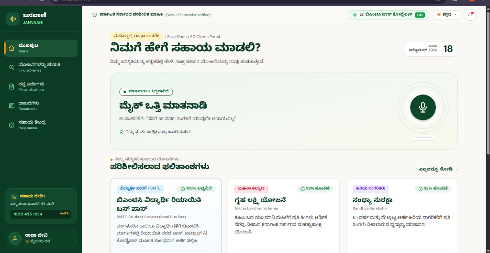

# 🏛️ JanVaani (ಜನವಾಣಿ)

> **Kannada-First, Voice-First AI Civic Copilot & e-Governance Gateway for Karnataka Citizens**

[](https://www.typescriptlang.org/)
[](https://bun.sh/)
[](https://github.com/Sriram-Nambiar/JanVaani)
[](https://github.com/Sriram-Nambiar/JanVaani)
[](LICENSE)

**JanVaani** (ಜನವಾಣಿ, meaning *"Voice of the People"*) is an intelligent, bilingual (Kannada & English) civic assistant designed to democratize access to Karnataka state welfare schemes, document checklists, and public utility services through conversational web portals, offline Grama One kiosks, and WhatsApp.

---



---

## 🌟 The Civic Challenge & Our Solution

Navigating government portals in India presents recurring accessibility hurdles for rural and urban citizens alike:

- **Fragmented Portals & Circulars:** Schemes like *Gruha Jyothi*, *Kaveri 2.0*, *Seva Sindhu*, and *Bhoomi* are spread across disjointed departmental portals with complex administrative circulars.
- **Language & Literacy Barriers:** Complex procedural circulars are frequently drafted in formal administrative English, alienating rural citizens and regional language speakers.
- **Opaque Verification & Rejections:** Missing document specifications (e.g. income certificates, caste affidavits, tuition receipts) lead to avoidable rejections without clear explanations.

**JanVaani bridges this gap** by combining:
1. **Voice-First Accessibility:** Inbound voice-note processing with AI speech recognition (Saaras STT) and multilingual text-to-speech.
2. **Deterministic Scheme Engines:** Statutory rule engines that calculate exact entitlements (e.g., zero-bill units, stamp duty slabs, scholarship grants, DBT cash assistance) with zero hallucinations.
3. **Omni-Channel Citizen Reach:** Dual web interfaces (Citizen Portal & Kiosk Dashboard) paired with WhatsApp bot integrations for instant mobile access.

---

## 🏛️ Integrated Karnataka Welfare Scheme Engines

JanVaani incorporates verified, deterministic calculation engines matching official Government of Karnataka statutes:

| Scheme | Department | Capabilities |
|---|---|---|
| **Gruha Jyothi** | Energy Dept (BESCOM, MESCOM, HESCOM, etc.) | Calculates 12-month average + 10% buffer (capped at 200 units), evaluating 100% Zero-Bill eligibility, partial subsidies, and domestic LT-2(a) tariff breakdowns. |
| **Kaveri 2.0** | Dept of Stamps & Registration | Property guidance valuation and stamp duty calculator applying statutory Karnataka slabs (2% affordable, 3% mid-segment, 5% standard), 10% infrastructure cess, and local body surcharges. |
| **Sandhya Suraksha** | Revenue Dept (Social Security) | Age (>= 65), annual income ceiling (<= ₹20,000), and occupation eligibility checker for the ₹1,200/month senior citizen pension. |
| **Vidyasiri (ePASS)** | Backward Classes Welfare Dept (BCWD) | Food & Accommodation Scheme (FAS) calculator evaluating student distance (>= 5 km), caste category, hostel residence, and disbursing ₹1,500/month. |
| **Bhoomi RTC** | Revenue Department | Rural land record verification, RTC survey number validation, and crop loan eligibility assessment. |
| **Anna Bhagya** | Food & Civil Supplies Dept | BPL/AAY card validation and ₹170/person/month cash entitlement in lieu of additional 5 kg rice allocation. |
| **Shakti Scheme** | Transport Dept (KSRTC, BMTC, NWKRTC, KKRTC) | Domicile verification and free state-wide ordinary bus travel pass issuance for Karnataka women and transgender citizens. |
| **Yuva Nidhi** | Skill Development & Livelihood Dept | Unemployment monthly assistance (₹3,000 for degree holders, ₹1,500 for diploma holders) with graduation gap validation. |
| **Mathrushree** | Women & Child Development | Financial assistance (₹6,000 cash + ₹4,000 Poshan kits) for pregnant and lactating mothers from BPL families. |
| **Arogya Karnataka** | Health & Family Welfare | Universal health coverage checker linking Ayushman Bharat health card benefits up to ₹5 Lakhs per family per year. |

---

## 🏗️ Monorepo Architecture

The repository is organized as a high-performance monorepo using **Bun workspaces**:

```
JanVaani/
├── apps/
│   ├── web/               # React 18 + Vite + Tailwind CSS Citizen Web App & WhatsApp Simulator
│   ├── seva-portal/       # Seva Sindhu Kiosk & Administrator Service Dashboard
│   ├── api/               # Express + TypeScript Civic Copilot, Scheme Engines & Baileys Gateway
│   └── seva-api/          # Seva Sindhu Application Engine, Feedback Store & Document Audit API
├── docs/
│   └── screenshots/       # Application UI captures and architecture artifacts
└── packages/              # Shared types, validation contracts, and configuration
```

### System Architecture Diagram

```
                              ┌────────────────────────────────────────┐
                              │             Citizen Users              │
                              └───────┬────────────────────────┬───────┘
                                      │                        │
                          Web Browser │                        │ WhatsApp / Voice
                                      ▼                        ▼
                      ┌──────────────────────┐      ┌──────────────────────┐
                      │    apps/web (SPA)    │      │ Baileys / Meta Cloud │
                      │   React 18 + Vite    │      │  WhatsApp Gateway    │
                      └──────────┬───────────┘      └──────────┬───────────┘
                                 │                             │
                                 ▼                             ▼
                      ┌────────────────────────────────────────────────────┐
                      │                  apps/api (Core)                   │
                      │  - Saaras Speech-to-Text & Audio Cache Engine      │
                      │  - 10+ Statutory Karnataka Scheme Calculators       │
                      │  - Rate Limiter, Correlation ID, Circuit Breaker   │
                      │  - Civic Audit Logger & Response Sanitizer         │
                      └──────────────────────┬─────────────────────────────┘
                                             │
                                             ▼
                      ┌────────────────────────────────────────────────────┐
                      │               apps/seva-api (Seva Sindhu)          │
                      │  - Application Persistence (Atomic File Store)     │
                      │  - Supplementary Document Re-upload & Audit Trail │
                      │  - Citizen Satisfaction Feedback Store             │
                      │  - Offline Kiosk Appointment Scheduler             │
                      └──────────────────────┬─────────────────────────────┘
                                             │
                                             ▼
                      ┌────────────────────────────────────────────────────┐
                      │               apps/seva-portal (Admin)             │
                      │  - Grama One & Bangalore One Operator Console      │
                      │  - Application Verification & Pass Generation      │
                      └────────────────────────────────────────────────────┘
```

---

## 🛡️ Security, Privacy & Reliability Guardrails

JanVaani adheres to strict public-sector data security protocols:

- **Strict PII Protection:** Citizen Aadhaar numbers and mobile numbers are masked (`XXXX-XXXX-1234` / `+******1234`) across all responses and API endpoints. Zero PII logging in console streams.
- **Fail-Safe Persistence:** All file-backed stores implement atomic write operations using temporary staging files with restricted permissions (`0o600`) to prevent file truncation or corruption.
- **Defense in Depth:** Configured with active rate limiters, payload size guards, ETag caching, connection draining, and HTTP compression negotiation.
- **Anti-Spoofing Identity Verification:** Feedback and document re-upload endpoints strictly enforce caller phone ownership against verified application records before mutating state.

---

## 🚀 Quick Start Guide

### Prerequisites
- [Bun](https://bun.sh/) (v1.1 or higher)
- [Node.js](https://nodejs.org/) (v20 or higher)
- [Git](https://git-scm.com/)

### 1. Clone & Install Dependencies

```bash
git clone https://github.com/Sriram-Nambiar/JanVaani.git
cd JanVaani
bun install
```

### 2. Start the Development Servers

Run the web interface, API backend, and Seva Sindhu services concurrently:

```bash
# Start all workspaces concurrently
bun run dev

# Or run individual workspaces:
bun run dev:web        # Citizen Dashboard (http://localhost:5173)
bun run dev:api        # Civic API Engine (http://localhost:3001)
bun run dev:seva-api   # Seva Sindhu API (http://localhost:3002)
```

---

## 🧪 Testing & Code Quality

The codebase enforces strict end-to-end type safety and automated testing across all packages:

```bash
# Run typechecks across all 4 workspaces
bun run typecheck

# Run full test suite (310+ tests across 18 test files)
bun run test

# Run tests for a specific scheme
bun test apps/api/src/routes/gruha-jyothi.test.ts
bun test apps/api/src/routes/kaveri.test.ts
```

All Pull Requests in the repository are continuously validated by automated CI and **Shipwright AI** for code quality, zero-PII exposure, and regression prevention.

---

## 📜 Contributing & Code of Conduct

We welcome contributions from civic technologists, developers, and linguistic experts passionate about improving governance accessibility in Karnataka:

1. Fork the repository and create your feature branch: `git checkout -b feat/my-new-feature`
2. Follow strict Zod validation patterns and ensure all inputs are sanitised.
3. Run `bun run typecheck` and `bun test` to confirm 0 errors.
4. Open a Pull Request referencing the related issue.

---

## 📄 License

This project is open-source and licensed under the [MIT License](LICENSE).
